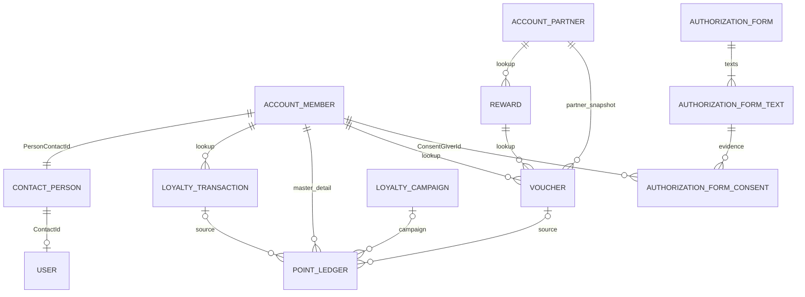

# Datový model EneOil Klub pro B1

Datum 6. 11. 2026. Stav: návrh k revizi, bez schválení implementace.

Doporučuji Person Account pro člena, Business Account pro EneServis, standardní objekty pro souhlasy a pět vlastních objektů pro nákupy, kampaně, pohyby bodů, odměny a vouchery. Zůstatek počítá standardní roll-up z pohybů. Samostatné členství, bodový účet ani obecný pravidlový engine nejsou pro jeden program potřeba.

Dokument pokrývá pouze datový model, jeho omezení a potřebný přístup k datům. Neobsahuje implementaci automatizací, portálu ani reportu. Navržená rozhodnutí nejsou záznamem souhlasu garanta.

## 1. Podklady a hranice návrhu

Východiskem je [zadání B1](../../implementation-blocks/B1-data-model-config/README.md) a [přiložený solution design](../../main/EneOil-Klub-Solution-Design.docx), především kapitoly 5 až 7, 10 a 11. Kopie DOCX v repozitáři je obsahově totožná s přílohou v Downloads, ověřeno SHA-256. Potřeby návazných bloků B2 a B5 až B9 slouží jako kontrola úplnosti modelu.

Starší [stručný návrh řešení](2026-11-06-eneoil-solution-design.md) doporučuje Contact a samostatné členství. Pro tento B1 návrh má přednost přiložený solution design a README B1, které již určují Person Account. Starší variantu proto nepřebírám.

Rozsah je jeden program, jedna bodová měna, CZK, jeden partner a jedno vozidlo v profilu člena. Nákup nemá položky. V základním modelu nejsou úrovně, expirace bodů, storno nákupu, PDF voucheru ani samostatná evidence stanic. Velikost návrhové práce je M, riziko střední kvůli sdílení osobních dat, neměnnosti účetní evidence bodů a souběžnému čerpání.

Stav skutečného Salesforce orgu a jeho licencí nebyl ověřen. Repozitář používá Metadata API 63.0. Návrh počítá se zapnutými Person Accounts, Experience Cloud a Data Protection and Privacy. Nevyžaduje Loyalty Management ani oborový cloud.

## 2. Rozhodnutí a jejich důvody

| ID | Navržené rozhodnutí | Důvod a důsledek |
| --- | --- | --- |
| D01 | Člen je standardní `Account`, Person Account. | Jeden program a jeden bodový zůstatek nevyžadují `Member__c` ani `LoyaltyMember__c`. Identita portálu využívá existující `PersonContactId`. |
| D02 | Partner je standardní Business Account. | EneServis má běžné firemní údaje a vlastní odměny. Nevzniká `Partner__c`. Hodnota `Type = Partner` sama nezapíná partnerský portál. |
| D03 / OP-06 | Kampaň je `Loyalty_Campaign__c`. | Standardní `Campaign` byl posouzen, ale zvolená licence Customer Community nemá přímý přístup ke Campaign. Vlastní objekt umožní jednoduché čtení akcí v portálu bez druhé publikované kopie. |
| D04 | Nákup je `Loyalty_Transaction__c`. | `Order` a `Opportunity` zavádějí obchodní procesy a vazby, které zadání nepotřebuje. Nákup je pouze externí událost pro připsání bodů. |
| D05 | `Point_Ledger__c.Member__c` je master-detail na Account. | Zůstatek poskytne standardní SUM roll-up. Pohyby přebírají přístup člena. Nutná je výslovná ochrana před smazáním rodiče. |
| D06 | Pohyb bodů je po vytvoření neměnný. | Oprava přidá kompenzační pohyb. Zůstatek se nikdy přímo nepřepisuje. |
| D07 | Odměna a vydaný voucher jsou dva vlastní objekty. | Katalog se mění, vydaný závazek musí zachovat cenu, hodnotu a popis. `Product2`, ceníky a objednávky by přidaly nepotřebnou produktovou strukturu. Standardní objekty Loyalty Management jsou mimo zadání. |
| D08 | Souhlasy využívají `AuthorizationForm`, `AuthorizationFormText` a `AuthorizationFormConsent`. | Standardní evidence uchová přesné znění, verzi, autora a okamžik projevu. Nevzniká vlastní objekt souhlasů. |
| D09 | Jednorázovost hlídají unikátní klíče pohybů a požadavků na voucher. | Checkbox ani předchozí dotaz nezaručí jednorázovost při souběhu. Unikátní omezení je poslední databázová pojistka. |
| D10 | Jeden základní pohyb a jeden pohyb za každou splněnou kampaň. | Zachová se jednoduché párování i audit kampaní. Splněná kampaň s nulovým bonusem vytvoří nulový pohyb, aby nezmizela z reportu. |
| D11 | Číslo člena je Text, Unique a External ID, odvozené z Account ID. | Odpadá vlastní čítač i pomocné pole. Číslo je stabilní a lze přes něj párovat import. Formát není v zadání předepsán. |
| D12 | Stanice jsou odložené SHOULD. | Povinné KPI je nepotřebují. Pokud se zařadí, použije se Business Account s record typem `Fuel_Station`, nikoli `Station__c`. |
| D13 | Parametry výpočtu jsou v `Loyalty_Settings__mdt`, kampaně a katalog v datech. | Technické sazby lze spravovat v Setup. Manažer mění akce a odměny v běžných záznamech bez nasazení. |
| D14 | Rozpočet je informativní, na partnerovi pro jeden zvolený rok. | Nevzniká samostatný finanční subsystém. Víceletá historie rozpočtů a tvrdé blokování čerpání nejsou součástí základního modelu. |

U D03 jde o vědomou výjimku z preference standardních objektů. [Oficiální matice Experience Cloud licencí](https://help.salesforce.com/s/articleView?id=sf.customer_portal_users.htm&language=en_US&type=5) uvádí přístup ke Campaign pro partnerské licence, nikoli pro Customer Community. Permission set chybějící oprávnění licence nerozšíří. Nedoporučuji tento rozdíl řešit zpřístupněním Campaign v systémovém režimu.

Zvažované alternativy pro OP-06:

| Varianta | Výhoda | Náklad pro toto zadání | Závěr |
| --- | --- | --- | --- |
| `Campaign` a record type `Loyalty` | Standardní interní správa a reporty. | Akce nelze členům přímo sdílet při zvolené licenci. Další publikovaná kopie přidá synchronizaci. `CampaignMember` navíc nereprezentuje jednotlivá splnění nákupem. | Použít pouze při změně licenčních a portálových podmínek. |
| `Loyalty_Campaign__c` | Jeden záznam pro pravidlo, interní správu i portál. | Jeden vlastní objekt. | Doporučeno. |
| Custom Metadata pro kampaně | Konfigurace se dá verzovat spolu s aplikací. | Nevhodné pro běžnou práci manažera a provozní reporty. | Ponechat jen pro globální parametry. |

## 3. Přehled objektů a vazeb

Základ obsahuje pět vlastních datových objektů a jeden Custom Metadata Type. Standardní `Contact` a `User` slouží k identitě; nevytvářejí další evidenci členství.

Všechny členské vazby směřují na `Account.Id`, nikoli na Contact. Výjimkou je standardní `User.ContactId = Account.PersonContactId`. `ConsentGiverId` podporuje Account, takže pro tento rozsah není potřeba zakládat také `Individual`.

| Vazba | Povinnost a chování při smazání |
| --- | --- |
| Transakce → člen | Povinný lookup, zákaz smazání odkazovaného člena. |
| Pohyb → člen | Povinný master-detail, reparenting vypnutý. Salesforce by při smazání Accountu kaskádově smazal pohyby, proto musí aplikační ochrana smazání člena blokovat. |
| Voucher → člen, odměna, partner | Tři povinné lookupy se zákazem smazání odkazovaného záznamu. Partner je kopie vazby platné při vydání. |
| Odměna → partner | Povinný lookup se zákazem smazání partnera. |
| Pohyb → transakce, kampaň, voucher, opravovaný pohyb | Volitelné lookupy podle typu pohybu, vždy bez kaskády a se zákazem smazání odkazovaného záznamu. |
| Souhlas → člen a text formuláře | Standardní vazby. Jejich chování se nepovažuje za ochranu historie; mazání členů i použitých textů blokují oprávnění a aplikační pravidla. |

## 4. Datový slovník

API názvy a uložené hodnoty picklistů jsou anglicky. Uživatelské názvy polí a překlady picklistů spravuje metadata a Translation Workbench. Texty komponent a chybových hlášení patří do Custom Labels. `Number(p,s)` označuje celkový počet číslic a počet desetinných míst. Všechny body jsou celá čísla.

### 4.1 Account pro člena

Použijí se standardní `FirstName`, `LastName`, `PersonEmail`, `PersonMobilePhone`, `PersonContactId`, `IsPersonAccount` a auditní pole. Telefon je volitelný, jméno, příjmení a e-mail vyžaduje registrace. Pro tento program stačí jeden existující Person Account record type. Členství identifikuje vyplněné `Member_Number__c`, nikoli samotné `IsPersonAccount`.

| Vlastní pole | Typ | Pravidlo |
| --- | --- | --- |
| `Member_Number__c` | Text(30), External ID, Unique bez rozlišení velikosti písmen | Povinné pro dokončenou registraci, neměnné. Generuje server, uživatel je nezadává. |
| `Membership_Status__c` | Picklist `Active`, `Blocked`, `Cancelled` | Povinné pro člena. `Blocked` a `Cancelled` zakazují nové nákupy, bonusy a směnu. Řízené opravy zůstávají možné. Zrušení členství zachová historii. |
| `Joined_At__c` | DateTime | Skutečný okamžik registrace. Pro historická seed data se nepoužívá dnešní `CreatedDate`. |
| `Points_Balance__c` | Roll-Up Summary, SUM | Součet `Point_Ledger__c.Points__c` bez filtru. Prázdný účet má nulu. |
| `Vehicle_Make__c` | Text(80) | Značka vozidla. |
| `Vehicle_Model__c` | Text(80) | Model vozidla. |
| `Vehicle_Fuel_Type__c` | Restricted picklist | `Petrol`, `Diesel`, `LPG`, `CNG`, `Electric`, `Hybrid`, `Other`. |
| `Vehicle_Year__c` | Number(4,0) | Rok výroby, při vyplnění od 1900 do aktuálního roku + 1. |
| `Vehicle_Registration__c` | Text(20) | Volitelná SPZ, bez globální uniqueness. |
| `Profile_Complete__c` | Formula Checkbox | Všechna čtyři povinná pole vozidla jsou vyplněna a validní. |
| `Marketing_Consent__c` | Checkbox, výchozí false | Serverem udržovaný aktuální stav podle evidence souhlasů. Není dokladem jednorázového připsání. |

Číslo člena vznikne po insertu jako `ENE-` a 18znakové Salesforce Account ID. Server jej uloží ještě v rámci dokončení registrace. Číslo je veřejný identifikátor karty, ne autentizační údaj. Mezery se při vstupu odstraní, velikost písmen se normalizuje. Hodnota se zrušeným členstvím neuvolňuje a při obnově stejného členství se zachová. Account bez hotového čísla a data registrace nesmí přijímat věrnostní operace.

Tento formát upřednostňuje minimum pomocných polí před krátkou číselnou kartou. Pokud vznikne požadavek na krátké pořadové číslo, lze přidat standardní Auto Number jako zdroj a kopírovat jej do stávajícího textového External ID. Vlastní čítač ani výpočet `MAX + 1` se nepoužije.

Dokončený profil je aktuální vlastnost, získaný bonus je historický pohyb. Po smazání modelu auta se formula změní na false, ale dřívější bonus zůstane a další doplnění nepřidá druhý.

### 4.2 Account pro partnera

EneServis využívá standardní `Name`, `Type = Partner`, `BillingAddress`, `Phone` a `Website`. Jeden Business Account record type postačí. Odměny vyžadují lookup filter `IsPersonAccount = false` a `Type = Partner`, doplněný validací při zápisu. Věrnostní pole člena zůstávají prázdná.

| Vlastní pole | Typ | Pravidlo |
| --- | --- | --- |
| `Voucher_Budget_Year__c` | Number(4,0) | Rok informativního rozpočtu. |
| `Voucher_Budget_CZK__c` | Currency(16,2) | Nezáporný roční rozpočet partnera. Vyplněná částka vyžaduje rok a naopak. |

Report porovnává rozpočet pouze s vouchery vydanými v uvedeném roce. Pro jiný rok zobrazuje chybějící rozpočet, nikoli poslední známou částku. Rozpočet zatím nezastavuje vydávání voucherů. Pokud bude vyžadována víceletá historie, doplní se samostatný záznam partner–rok; přepisované pole na Accountu ji neposkytuje.

### 4.3 Loyalty_Transaction__c

Jeden záznam představuje jeden zaplacený nákup. `Name` je Auto Number `TX-{00000000}`. Objekt má vlastníka, interní i externí OWD Private a povolené reporty.

| Pole | Typ | Pravidlo |
| --- | --- | --- |
| `Member__c` | Lookup(Account), required | Pouze zaregistrovaný Person Account. |
| `POS_Transaction_Id__c` | Text(100), External ID, Unique bez rozlišení velikosti písmen | Povinné stabilní ID vstupu. Při více pokladnách tvar `source:receipt-id`. |
| `Purchased_At__c` | DateTime, required | Skutečný čas nákupu, nesmí být v budoucnosti. |
| `Total_Amount__c` | Currency(16,2), required | Celkem, větší než nula. |
| `Fuel_Amount__c` | Currency(16,2), required | Palivo, nejméně nula. |
| `Other_Amount__c` | Currency(16,2), required | Ostatní, nejméně nula. |
| `Liters__c` | Number(12,3), required | Litry, nejméně nula. |
| `Processing_Status__c` | Picklist `Pending`, `Processed`, `Error` | Výchozí `Pending`, změny řídí server. |
| `Processing_Error__c` | Long Text Area(32768) | Interní důvod neúspěšného zpracování, povinný při `Error`. |
| `Processed_At__c` | DateTime | Povinné při `Processed`. |
| `Base_Fuel_Points__c` | Number(12,0) | Uložený výsledek při zpracování. |
| `Base_Other_Points__c` | Number(12,0) | Uložený výsledek při zpracování. |
| `Campaign_Points__c` | Number(12,0) | Součet skutečných bonusů kampaní. |
| `Total_Points__c` | Formula Number(12,0) | Součet tří předchozích polí. |

Částky validuje pravidlo `Fuel_Amount__c + Other_Amount__c = Total_Amount__c`. Současně platí `Fuel_Amount__c > 0` právě tehdy, když `Liters__c > 0`. Povinné nuly se předávají explicitně. Výpočty používají Decimal a CZK se dvěma desetinnými místy.

Po zpracování jsou nákupní údaje, člen a výsledky neměnné. Opakované POS ID se stejným obsahem vrátí existující výsledek. Stejné ID s jiným obsahem je konflikt, nikoli pokyn k aktualizaci nákupu. Idempotenci proto nelze nahradit neomezeným upsertem podle External ID.

Zjednodušení vůči kapitole 6.1 DOCX: strukturálně nevalidní CSV řádky a neznámí členové se odmítnou do chybového výstupu importu. Nevytváří se druhý staging objekt ani neúplné nákupy bez člena. Stav `Error` slouží pro validní uložený nákup, jehož zpracování selhalo, například kvůli blokovanému členovi. B3 musí uchovat ID, číslo řádku a důvod odmítnutí. Pokud má být každý chybný surový řádek dostupný přímo v Salesforce, jde o rozšíření rozsahu o vstupní evidenci.

### 4.4 Loyalty_Campaign__c

`Name` je název akce pro člena. Nezavádí se seznam účastníků. Všechny kampaně platí pro všechny aktivní členy, když nákup splní podmínku. Objekt má vlastníka, interní i externí OWD Public Read Only. Jeho záznamy neobsahují neveřejné interní plánování.

| Pole | Typ | Pravidlo |
| --- | --- | --- |
| `Is_Enabled__c` | Checkbox, výchozí false | Výslovné povolení použití pravidla. |
| `Start_Date__c`, `End_Date__c` | Date, required | Oba krajní dny patří do platnosti. Začátek nesmí být po konci. |
| `Condition_Field__c` | Restricted picklist, required | `Liters`, `OtherAmount`, `FuelAmount`, `TotalAmount`. |
| `Threshold__c` | Number(16,3), required | Nezáporný práh pro operátor ≥. Peněžní práh má nejvýše dvě desetinná místa. |
| `Reward_Type__c` | Restricted picklist, required | `FixedBonus` nebo `BaseMultiplier`. |
| `Reward_Value__c` | Number(12,4), required | Pevný bonus je kladné celé číslo. Násobitel je alespoň 1. |
| `Member_Description__c` | Long Text Area(32768) | Schválený text pro portál. |
| `Is_Portal_Visible__c` | Formula Checkbox | Povolená kampaň a dnešní datum v platnosti. |

Podmínka je vždy jediná, typu veličina ≥ práh. Nevznikají samostatné objekty podmínek, akcí, segmentů ani konfigurovatelné názvy Salesforce polí. Tím se omezuje počet stavů, které musí engine podporovat.

Platnost engine určuje podle kalendářního dne nákupu v `Europe/Prague`, nikoli podle času importu nebo portálové formule `TODAY()`. Historická kampaň zůstává pro zpracování opožděných nákupů povolená i po svém koncovém dni. `Is_Enabled__c = false` ji vyřadí ze všech dalších výpočtů, včetně opožděných nákupů. Už zapsané pohyby nezmění. To je explicitní výklad deaktivace pro T24.

Po prvním použití se výpočetní pole a datumy kampaně nemění. Nové pravidlo znamená nový záznam s novou platností. Název a popis lze upravit. Vypnutí slouží pro výjimečné zastavení akce. Evidence historie polí je doplňkový audit, nikoli zdroj pro přepočet starých transakcí.

### 4.5 Point_Ledger__c

Jeden záznam je jedno zaúčtované připsání, odečtení nebo prokazatelné splnění kampaně s nulovým výsledkem. `Name` je Auto Number `PT-{00000000}`. Objekt nemá vlastníka, přístup je Controlled by Parent. Nemá koncept Draft ani Posted, každý uložený pohyb již patří do zůstatku.

| Pole | Typ | Pravidlo |
| --- | --- | --- |
| `Member__c` | Master-Detail(Account), required | Person Account se členstvím. Reparenting vypnutý. |
| `Points__c` | Number(12,0), required | Podepsaný počet bodů, kladný přírůstek a záporný úbytek. |
| `Entry_Type__c` | Restricted picklist, required | `PurchaseBase`, `CampaignBonus`, `ProfileBonus`, `MarketingBonus`, `Redemption`, `Refund`, `Adjustment`. |
| `Occurred_At__c` | DateTime, required | Obchodní čas pohybu. U nákupu a kampaně čas nákupu, u směny nebo aktivity aktuální čas akce. |
| `Unique_Key__c` | Text(200), External ID, Unique bez rozlišení velikosti písmen | Povinný serverový klíč podle zdroje. |
| `Transaction__c` | Lookup(Loyalty_Transaction__c) | Povinné pro `PurchaseBase` a `CampaignBonus`. |
| `Campaign__c` | Lookup(Loyalty_Campaign__c) | Povinné pouze pro `CampaignBonus`. |
| `Voucher__c` | Lookup(Voucher__c) | Povinné pro `Redemption` a `Refund`. |
| `Reverses_Entry__c` | Lookup(Point_Ledger__c) | Povinné pro `Refund`, odkazuje na původní odpočet. |
| `Reason__c` | Text(255) | Povinné pro ruční úpravu a vrácení. |

Ostatní zdrojová pole musí být pro daný typ prázdná. Člen na pohybu musí odpovídat členovi zdrojové transakce nebo voucheru. Vazby ověřuje server i při importu. `CreatedDate` a `CreatedById` poskytují čas a autora zápisu, nezaměňují se s obchodním časem.

Kladné body mají typy `PurchaseBase`, `ProfileBonus`, `MarketingBonus` a `Refund`. `Redemption` je vždy záporný. `Adjustment` je nenulový s oběma znaménky a je vyhrazený pro SHOULD ruční opravy. Pouze `CampaignBonus` a `PurchaseBase` dovolují nulu. Nulový základ je možný při malém nákupu, například 10 Kč bez paliva.

Pro audit bonusů se při vytvoření `CampaignBonus` uloží kopie čtyř polí `Applied_Condition_Field__c`, `Applied_Threshold__c`, `Applied_Reward_Type__c` a `Applied_Reward_Value__c`. Mají odpovídající typy polí kampaně. Ostatní pohyby je mají prázdné. Tato kopie zachová vysvětlení výsledku i při pozdějším administrativním zásahu do konfigurace.

| Událost | Formát `Unique_Key__c` | Počet záznamů |
| --- | --- | --- |
| Základ nákupu | `TX:<transaction-id>:BASE` | Právě jeden na zpracovaný nákup. |
| Splněná kampaň | `TX:<transaction-id>:CAM:<campaign-id>` | Právě jeden na nákup a splněnou kampaň, i při 0 bodech. |
| Dokončení profilu | `MEM:<account-id>:PROFILE` | Nejvýše jeden za život členství. |
| První marketingový souhlas | `MEM:<account-id>:MARKETING` | Nejvýše jeden za život členství. |
| Odečtení za voucher | `VCH:<voucher-id>:REDEEM` | Právě jeden na voucher. |
| Vrácení zrušeného voucheru | `VCH:<voucher-id>:REFUND` | Nejvýše jeden na voucher. |
| Ruční úprava | `ADJ:<request-uuid>` | Nejvýše jeden na požadavek. |

Zůstatek je `SUM(Points__c)`. Další celoživotní součty na Accountu zatím nevznikají; report je získá agregací podle typu a období. Standardní [roll-up summary](https://trailhead.salesforce.com/en/content/learn/modules/point_click_business_logic/roll_up_summary_fields) vyžaduje přímý master-detail vztah, který tento model poskytuje.

Odečítající operace musí zamknout Account, znovu načíst zůstatek a provést kontrolu i zápis v jedné databázové transakci. Stejný protokol používají všechny zapisující operace. Samotný roll-up souběžné přečerpání neřeší. Validační pravidlo na Accountu zakáže `Points_Balance__c < 0` jako další pojistku. B2 a B8 implementují atomický zápis, nikoli vlastní druhé pole zůstatku.

### 4.6 Reward__c

`Name` je název odměny, objekt má vlastníka a interní i externí OWD Public Read Only. Jde o společný katalog bez neveřejných obchodních údajů.

| Pole | Typ | Pravidlo |
| --- | --- | --- |
| `Partner__c` | Lookup(Account), required | Business Account partnera. |
| `Points_Cost__c` | Number(12,0), required | Cena musí být větší než nula. |
| `Value_CZK__c` | Currency(16,2), required | Nezáporná nominální hodnota pro reporting. |
| `Is_Active__c` | Checkbox, výchozí false | Pouze aktivní odměnu lze nově čerpat. |
| `Description__c` | Long Text Area(32768) | Podmínky odměny pro člena, povinné před aktivací. |
| `Sort_Order__c` | Number(5,0) | Volitelné pořadí katalogu. |

Katalog nevede zásoby, rezervace, platební cenu ani ceník. Změna odměny ovlivňuje pouze budoucí vouchery. Deaktivace již vydané vouchery neruší.

### 4.7 Voucher__c

`Name` je Auto Number `VCH-{00000000}`. Kód k nadiktování je samostatné pole. Objekt má vlastníka a interní i externí OWD Private.

| Pole | Typ | Pravidlo |
| --- | --- | --- |
| `Member__c` | Lookup(Account), required | Držitel voucheru. |
| `Reward__c` | Lookup(Reward__c), required | Zdrojová katalogová odměna. |
| `Partner__c` | Lookup(Account), required | Kopie partnera při vydání, pro stabilní reporty a oprávnění operátora. |
| `Code__c` | Text(13), Unique bez rozlišení velikosti písmen | Povinné `ENE-XXXX-XXXX`, pouze znaky `ABCDEFGHJKMNPQRSTUVWXYZ23456789`. |
| `Request_Key__c` | Text(80), External ID, Unique bez rozlišení velikosti písmen | Povinné `account-id:request-uuid`. Tentýž požadavek po opakování vrátí tentýž voucher. |
| `Status__c` | Restricted picklist `Issued`, `Redeemed`, `Cancelled` | Výchozí `Issued`. |
| `Points_Spent__c` | Number(12,0), required | Kladná kopie bodové ceny při vydání. |
| `Value_CZK__c` | Currency(16,2), required | Kopie nominální hodnoty při vydání. |
| `Reward_Name__c` | Text(80), required | Kopie názvu odměny při vydání. |
| `Reward_Description__c` | Long Text Area(32768), required | Kopie podmínek odměny při vydání. |
| `Issued_At__c` | DateTime, required | Obchodní okamžik vydání, odlišný od importního `CreatedDate`. |
| `Redeemed_At__c` | DateTime | Povinné při `Redeemed`. |
| `Redeemed_By__c` | Lookup(User) | Operátor, povinný při `Redeemed`. |
| `Cancelled_At__c` | DateTime | Povinné při `Cancelled`. |
| `Cancellation_Reason__c` | Text(255) | Povinné při `Cancelled`. |
| `Email_Status__c` | Picklist `Pending`, `Sent`, `Error` | Výchozí `Pending`, nezávislé na stavu voucheru. |
| `Email_Sent_At__c` | DateTime | Čas úspěšného předání zprávy k odeslání, nikoli důkaz doručení. |
| `Email_Error__c` | Text(255) | Poslední chyba odeslání, interní. |

Voucher nemá datum expirace. Při vydání musí souhlasit člen, partner i odměna a vznikne pohyb `Redemption` o hodnotě `-Points_Spent__c`. Cena, hodnoty, kód, vazby a čas vydání se následně nemění.

Povolené přechody jsou `Issued → Redeemed` a `Issued → Cancelled`. Zrušení vyžaduje současné vrácení přes pohyb `Refund`; bez této funkce se přechod do `Cancelled` nepovolí. Již uplatněný voucher základní návrh neruší. Operátor nemá přímý obecný Edit, přechod provádí řízená akce. Ze stavu `Redeemed` ani `Cancelled` není návrat.

Kód generuje server náhodně. Unikátní pole garantuje databázovou jedinečnost, při kolizi se generování omezeně opakuje. Kód se nesmí považovat za oprávnění k načtení cizích dat. UUID požadavku zůstává stejné při dvojkliku i síťovém retry. Nové UUID je nová směna.

### 4.8 Standardní evidence souhlasů

Souhlas s podmínkami a marketingový souhlas jsou dvě oddělená znění a dvě oddělené řady událostí. Použijí se tyto standardní objekty:

| Objekt | Použití |
| --- | --- |
| `AuthorizationForm` | Jedna verze podmínek nebo marketingového textu. Standardní `Name`, `RevisionNumber`, `EffectiveFrom`, `EffectiveTo` a výchozí text `DefaultAuthFormTextId`. Navíc `Consent_Type__c`, restricted picklist `Terms`, `Marketing`. |
| `AuthorizationFormText` | Pojmenované české znění verze, vazba `AuthorizationFormId`, `Locale`, text v `DetailAuthorizationFormText`. Použité znění se nepřepisuje, změna vytvoří novou verzi formuláře i textu. |
| `AuthorizationFormConsent` | Pojmenovaná událost člena s vazbou `ConsentGiverId = Account.Id`, textem `AuthorizationFormTextId`, časem `ConsentCapturedDateTime`, zdrojem `ConsentCapturedSource` a `ConsentCapturedSourceType`. |

`AuthorizationFormConsent` navíc dostane `Consent_Action__c`, restricted picklist `Accepted`, `Declined`, `Withdrawn`. Přijetí má standardní `Status = Signed`, odmítnutí a odvolání `Status = Rejected`. Vlastní pole rozliší poslední dvě situace, protože standardní Status samostatné `Withdrawn` nemá. Nová událost vždy vytvoří nový záznam, starší souhlas se nepřepisuje.

Tento výběr využívá standardní [AuthorizationForm](https://developer.salesforce.com/docs/platform/object-reference/references/standard-objects/object-authorizationform.html), [AuthorizationFormText](https://developer.salesforce.com/docs/platform/field-reference/references/field-reference/salesforce-field-reference-authorizationformtext.html) a [AuthorizationFormConsent](https://developer.salesforce.com/docs/platform/object-reference/references/standard-objects/object-authorizationformconsent.html). Objekty vyžadují zapnuté Data Protection and Privacy. Polymorfní `ConsentGiverId` podporuje Account. Nejde o závislost na Financial Services Cloud.

Aktuální stav marketingu se odvodí z poslední události typu Marketing podle serverového času a udržuje se také v `Account.Marketing_Consent__c`. Pořadí změn jednoho člena řídí stejný zámek Accountu. Přijetí podmínek je povinné pro dokončení registrace, marketing je volitelný. Odvolání marketingu nevrací body. Nové přijetí nepřidá další bonus, protože existuje klíč `MEM:<account-id>:MARKETING`.

Portál nepotřebuje přímý CRUD přístup k těmto objektům. Serverová akce přijímá pouze výslovnou volbu člena a ID právě zveřejněného textu, člena určuje z přihlášeného uživatele. Neumožní předat cizí `ConsentGiverId`, vlastní čas ani libovolný stav. Zpřístupnění standardních consent objektů konkrétní interní a externí licenci se ověří před B7, nikoli předpokládá podle existence objektu.

Samotný checkbox na Accountu ani standardní historie změn polí tento model nenahrazují. Předmětem návrhu je technická evidence projevu a textu, nikoli posouzení marketingové politiky.

### 4.9 Loyalty_Settings__mdt

Jediný záznam `Default`, spravovaný administrátorem. Pole jsou Number, bez obecných dvojic klíč–hodnota.

| Pole | Typ | Výchozí hodnota |
| --- | --- | ---: |
| `Fuel_Points_Per_Liter__c` | Number(8,0) | 1 |
| `Other_CZK_Per_Point__c` | Number(12,2) | 20 |
| `Profile_Bonus_Points__c` | Number(12,0) | 100 |
| `Marketing_Bonus_Points__c` | Number(12,0) | 50 |

Všechny čtyři hodnoty musí být větší než nula. Tuto podmínku ověřuje služba při načtení nastavení, ne až po částečném připsání. Chybějící nebo nevalidní konfigurace zastaví operaci bez pohybů. Pro základní sazby platí `floor(liters) × Fuel_Points_Per_Liter__c` a `floor(other / Other_CZK_Per_Point__c)`.

Změna sazeb platí pro nově zpracovávané nákupy. Již uložené výsledky se nepřepočítávají. Historické verzování sazeb k datu nákupu je rozšíření, které singleton nezajišťuje. Při seedování historických dat zůstanou sazby stejné. Parametry expirace a úrovní se nepřidávají před schválením těchto funkcí.

## 5. Oprávnění a vlastnictví

Členské Accounty vlastní interní uživatel určený pro správu členů, s potřebnou rolí pro založení externího uživatele. Portálový User nevlastní bodové pohyby ani transakce. Katalog, kampaně a partnera vlastní interní manažer. Technické záznamy vytváří server s dohledatelným autorem.

| Objekt | Interní OWD | Externí OWD a sdílení |
| --- | --- | --- |
| Account | Private | Private. Sharing set mapuje `User.AccountId → Account.Id`, pouze vlastní Person Account, Read Only. |
| Contact | Controlled by Parent | Přístup od vlastního Person Accountu, bez hromadného zpřístupnění kontaktů. |
| Loyalty Transaction | Private | Private. Sharing set `User.AccountId → Member__c`, Read Only. |
| Point Ledger | Controlled by Parent | Dědí z vlastního Accountu, samostatný sharing set není potřeba. |
| Voucher | Private | Private. Sharing set `User.AccountId → Member__c`, Read Only. |
| Loyalty Campaign | Public Read Only | Public Read Only, společné akce bez osobních údajů. Žádné sdílení podle člena. |
| Reward | Public Read Only | Public Read Only, společný katalog bez osobních údajů. Žádné sdílení podle člena. |
| Consent objekty | Interní omezený přístup | Žádný přímý přístup člena, obsluha přes vymezenou serverovou akci. |

Public Read Only umožňuje přihlášenému členovi přečíst i neaktivní odměnu nebo budoucí kampaň, pokud zná její ID. Portálový seznam je filtruje, ale filtr není bezpečnostní hranice. Základní model tento přístup výslovně přijímá. Aktivita omezuje možnost čerpání a vyhodnocení, nikoli utajení záznamu. Neveřejné poznámky ani připravované tajné nabídky se do těchto objektů neukládají. Guest profil nedostane objektové Read oprávnění.

Tato volba odpovídá [pravidlům pro high-volume uživatele](https://help.salesforce.com/s/articleView?id=platform.networks_about_hvpu.htm&language=en_US&type=5), kam patří Customer Community. Nepočítá se s přidáním těchto členů do veřejných skupin či standardních role-based sharing rules. Externí OWD nesmí být volnější než interní, proto je Public Read Only nastavené na obou stranách. Pokud budou nutné skutečně neveřejné koncepty, musí se změnit publikační model a jeho přístupová cesta. Samotný další checkbox záznam neschová.

Sharing sets jsou určeny pro mapování uživatele na Account nebo Contact a následné záznamy. Konkrétní podporu objektů a mapování je nutné ověřit podle [Salesforce postupu pro sharing set](https://help.salesforce.com/s/articleView?id=sf.networks_setting_light_users.htm&language=en_US&type=0) v cílovém orgu. FLS a CRUD zůstávají samostatnou podmínkou přístupu.

Permission set skeletony mají tento rozsah. C, R a U znamenají Create, Read a Update, Delete běžné role nedostávají.

| Permission set | Datový přístup | Zápis řízenou akcí |
| --- | --- | --- |
| `Loyalty_Manager` | C/R/U členů, partnerů, kampaní a odměn, C/R vstupních transakcí, R pohybů a voucherů. Read přístup ke consent evidenci. | Blokace člena, oprava bodů, zrušení voucheru, změna již použité konfigurace pouze podle pravidel modelu. |
| `Loyalty_Back_Office` | R členů, katalogu a kampaní, C/R transakcí, R pohybů a voucherů. | Povolené úpravy profilu a případné SHOULD reklamace. Bez správy sazeb. |
| `Loyalty_Transaction_Import` | API přístup, R čísla a stavu člena, C/R transakcí. Bez editace zůstatku, pohybů a voucherů. | Pouze zpracování vstupu. |
| `Loyalty_Reporting` | Jen R a nezbytné reportové FLS, přístup k agregovaným datům všech členů. Bez e-mailu, vozidla, textů souhlasů a kódu voucheru. | Žádný. |
| `Loyalty_Member` | R vlastního Accountu, pohybů, transakcí a voucherů, R členských polí katalogu a kampaní. | Vlastní profil, vlastní souhlas a směna přes serverové akce. Bez přímého C/U pohybů a voucherů. |
| `Loyalty_Service_Operator` | Bez čtení Accountu a ledgeru, bez plošného čtení seznamu voucherů. | Vyhledání podle celého kódu a přechod do Redeemed přes úzkou oprávněnou akci pro EneServis. |

Permission set sám záznamy nesdílí. Interní skupiny dostanou odpovídající sharing rules; reportující uživatel dostane Read přístup ke všem potřebným záznamům bez nepotřebných osobních polí. Operátorská akce vrací jen kód, název odměny, stav a datum vydání. Vzhledem k jedinému partnerovi nemá model navíc tabulku vazeb uživatel–partner.

Server nesmí převzít členovo ID ze vstupu jako autoritu. V běžných čtecích cestách respektuje sharing a FLS. Vymezené zápisové služby mohou vytvářet chráněné pohyby po ověření přihlášeného člena nebo interního oprávnění; nejsou obecným CRUD rozhraním. Potřebné objekty a limity vlastních objektů ověří B0 proti skutečné licenci.

## 6. Historie a ochrana před smazáním

Zrušení členství nastaví `Cancelled`, deaktivace katalogu nastaví `Is_Active__c = false`. Žádná z těchto akcí nemaže účetní historii. Uživatelé nemají Delete na členských záznamech, transakcích, pohybech, voucherech ani použité konfiguraci.

Ochrana má dvě vrstvy. Oprávnění omezí běžné uživatele, server navíc odmítne update nebo delete pohybu a delete registrovaného Accountu. Ochrana rodiče je nutná i při master-detail, protože kaskáda při jeho smazání nemůže spoléhat na zákaz mazání detailu. Zablokuje se také sloučení registrovaných Person Accountů, které by měnilo vlastníka historie a identitu členství.

Pro kampaně a odměny se zapne field history na výpočetních polích, ceně, hodnotě, partnerovi a stavu. Na Accountu se sleduje stav členství. Historie polí je doplněk, nikoli trvalý ledger či úplná historie členství. Základní model přesně poskytne dnešní aktivní členy a registrace podle `Joined_At__c`; neumí bez další evidence rekonstruovat počet aktivních členů k libovolnému historickému dni.

Retenční lhůty podklady neurčují. Návrh proto nezavádí automatické mazání. Před produkčním provozem musí vlastník dat určit lhůty a schválený postup anonymizace nebo výmazu, včetně consent evidence, auditních polí a záloh. Technická neměnnost pohybů nesmí znamenat, že se osobní údaje budou bez rozhodnutí uchovávat navždy.

## 7. Podpora výpočtů a reportů

Tato část určuje datové kontrakty pro B2, B8 a B9, nikoli implementační plán.

| Scénář | Reprezentace v modelu |
| --- | --- |
| Nákup 45 l za 1 710 Kč a ostatní 180 Kč | Transakce uloží základ palivo 45 a ostatní 9. Pohyby budou `PurchaseBase +54`, `CampaignBonus +5` a `CampaignBonus +50`. Zůstatek vzroste o 109. |
| Nákup bez paliva za 150 Kč | Základ +7, splněný násobitel vytvoří bonus 0. Report přesto eviduje splnění kampaně. |
| Dvě kampaně s násobitelem | Každá má svůj pohyb `floor(base × multiplier) − base`. Bonusy se sčítají, násobitele se neskládají. |
| Směna 500 bodů ze zůstatku 740 | Voucher uchová cenu 500 a nominální hodnotu 200 Kč, pohyb je −500 a zůstatek 240. Při chybě nevznikne ani jeden záznam. |
| Souhlas udělen, odvolán a znovu udělen | Tři consent události, jeden pohyb +50. Poslední událost určuje aktuální checkbox. |
| Cena odměny se změní | Existující voucher stále ukazuje původní cenu, popis, partnera a hodnotu. |

Nákup a jeho pohyby se zapíší atomicky, stav Processed znamená úplnou evidenci. Voucher a odečtení bodů vzniknou také atomicky. Úspěšné vydání nezávisí na úspěchu následného e-mailu; opakování e-mailu nevytváří voucher ani další odpočet.

| KPI | Zdroj a význam |
| --- | --- |
| Registrovaní a dnešní aktivní členové | Account s číslem člena, `Joined_At__c`, aktuální `Membership_Status__c`. Historický stav členství je výslovně mimo základní model. |
| Připsané body | Součet kladných `PurchaseBase`, `CampaignBonus`, `ProfileBonus`, `MarketingBonus` podle `Occurred_At__c`. Refund ani ruční korekce nezvyšují získané body. |
| Čerpané body | Absolutní hodnota Redemption snížená o Refund, podle obchodního času jednotlivých pohybů. Samostatně lze vykázat hrubé směny. |
| Míra čerpání | Čerpané body / připsané body ve stejném období, nikoli průměr členských procent. Při nulovém jmenovateli bez hodnoty. Poměr může přesáhnout 100 %, pokud členové čerpají dříve získané body. |
| Oblíbené odměny a partneři | Počet voucherů podle `Reward__c`, uloženého `Partner__c` a `Issued_At__c`; stav rozlišuje uplatněné a zrušené. |
| Rozpočet voucherů | Součet uloženého `Voucher.Value_CZK__c` u voucherů vydaných v rozpočtovém roce, bez Cancelled, porovnaný s rozpočtem partnera. Zrušené hodnoty se vykazují samostatně. Jde o nominální hodnotu, ne vyúčtovaný náklad. |
| Kampaně | CampaignBonus seskupený podle kampaně: počet unikátních transakcí, členů a součet bonusu. Nulové bonusy se zahrnují do počtu splnění. |
| Rozpad palivo a ostatní | Uložené `Base_Fuel_Points__c` a `Base_Other_Points__c` na transakci. Připojením více kampaní se tyto částky nesmějí násobit v agregaci. |

Období se vyhodnocuje v `Europe/Prague`, časy se ukládají standardně jako DateTime. Souhrny nepoužívají importní CreatedDate místo obchodního data. Skutečný finanční náklad kampaně, historický stav rozpočtu ke dni a kauzální dopad na prodeje z těchto dat určit nelze.

## 8. Seed data a otevřené obchodní vstupy

Adresář `/data` v repozitáři při revizi neexistuje. Aktualizace existujících seedů není potřeba, B4 je vytvoří až po potvrzení modelu. Základní sada obsahuje EneServis, dvě kampaně ze zadání, tři odměny, verzi českých podmínek, verzi marketingového textu a metadata Default. Následují členové, nákupy a vouchery vzniklé přes stejné serverové operace jako v reálném provozu. Ledger se neplní nezávisle na zdrojových záznamech.

Historická registrace používá `Joined_At__c`, nákup `Purchased_At__c`, pohyb `Occurred_At__c` a voucher `Issued_At__c`. Seed nesmí naznačovat, že historické CreatedDate vzniklo běžným insertem. Pro SHOULD stanice se nejdřív doplní Account record type a volitelný lookup z transakce, teprve pak 120 záznamů stanic.

| Bod | Doporučení pro tento návrh | Co zůstává k potvrzení |
| --- | --- | --- |
| OP-06 | Vlastní objekt kampaně kvůli Customer Community. | Schválení volby při revizi B1. |
| Profil | Značka, model, palivo, rok; SPZ volitelná podle DOCX. | Zda se zavádí povinnost pro členy bez vozidla. Základ nenabízí jinou profilovou aktivitu. |
| OP-09 | Hodnoty 200 Kč a 500 Kč jsou dané, prohlídka má zatím navržených 2 000 Kč. | Skutečná hodnota prohlídky a roční rozpočet. Neschválená hodnota není ověřený finanční vstup. |
| OP-10 | Náhodný kód, databázová Unique ochrana a omezený retry. | Formát lze přijmout podle DOCX, algoritmus a počet retry patří do B8. |
| Retence | Žádné automatické mazání, běžné zrušení je změna stavu. | Konkrétní produkční lhůty a proces výmazu. |
| Rozsah reportu | Dnešní stav členství a rozpočet jednoho roku. | Zda B9 skutečně potřebuje historické stavy členství a víceletou historii rozpočtů. |
| Nevalidní vstupy | Odmítnutí do chybového souboru importu. | Zda je vyžadována i samostatná evidence surových chybných řádků v Salesforce. |

Neznámé obchodní hodnoty nebrání revizi struktury. Před aktivací odměny a před zveřejněním rozpočtového reportu musí být doplněny. Případná změna na více programů, více vozidel nebo více bodových měn by vyžadovala novou revizi, nikoli další pole bez změny modelu.

## 9. Ověření návrhu a následné ověření implementace

Při přípravě byla zkontrolována návaznost na B1, B2, B6 až B9, původ dat pro KPI, členění standardních a vlastních objektů a příklad 109 bodů. Byly posouzeny uniqueness, nulové bonusy, opravy, snapshoty, sdílení a kaskádové mazání. Ověření v orgu ani metadata deployment nejsou součástí tohoto výstupu.

Před převzetím pozdější implementace se nad skutečným orgem ověří:

1. Vytvoření člena, neměnné unikátní číslo a párování transakce přes External ID.
2. Odmítnutí nesouladu částek, nevalidního vozidla, záporné ceny, neplatných zdrojových vazeb a nesprávného přechodu voucheru.
3. Roll-up po +109, následné směně a případném vrácení. Přímá úprava zůstatku není dostupná.
4. Opakované POS ID, opakované aktivity, opakovaný request voucheru a dvě současné směny. Výsledkem je jediná oprávněná změna bez záporného zůstatku.
5. Nákup s nulovým základem a kampaň s nulovým bonusem. Evidence zachová idempotenci a reportové počty.
6. Změna odměny a zastavení kampaně. Existující pohyby a snapshoty voucherů se nezmění.
7. Dva různí členové v portálu včetně pokusu použít cizí ID. Ani jeden neuvidí transakce, pohyby, profil, souhlasy ani vouchery druhého.
8. Operátor vyhledá voucher a označí jej uplatněným, ale nedostane přístup ke zůstatku a historii člena. Reporting nečte kódy ani nepotřebné osobní údaje.
9. Delete a merge registrovaného Accountu, smazání detailu i zdrojových záznamů. Historie se nesmí ztratit kaskádou ani změnou vazeb.
10. Souhlas uchová původní text, datum a zdroj. Sekvence Accepted–Withdrawn–Accepted vytvoří jen jeden marketingový bonus.

Výstupem této práce je návrh datového modelu. XML metadata, permission sety, seed skripty, implementační plán a deployment vzniknou až jako navazující práce po jeho revizi.
